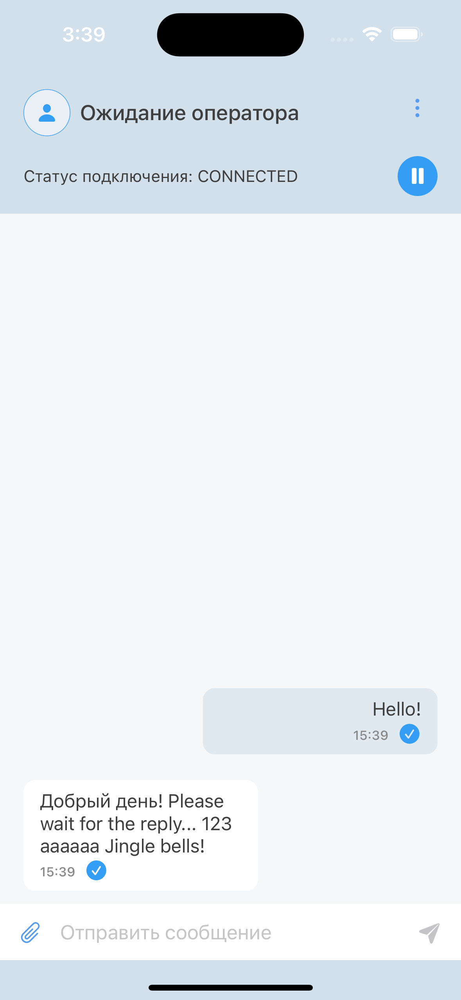
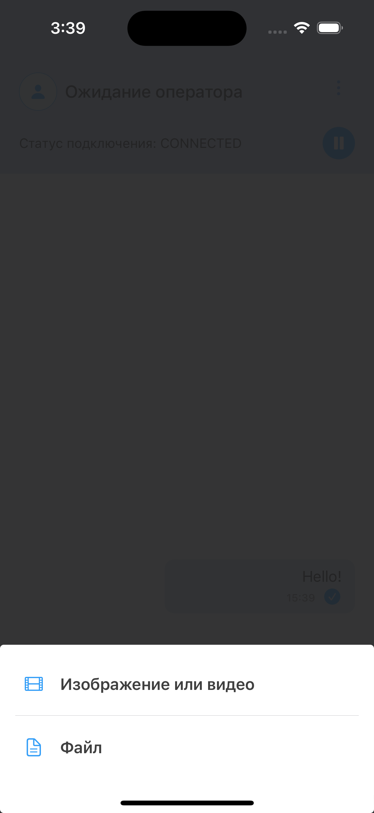
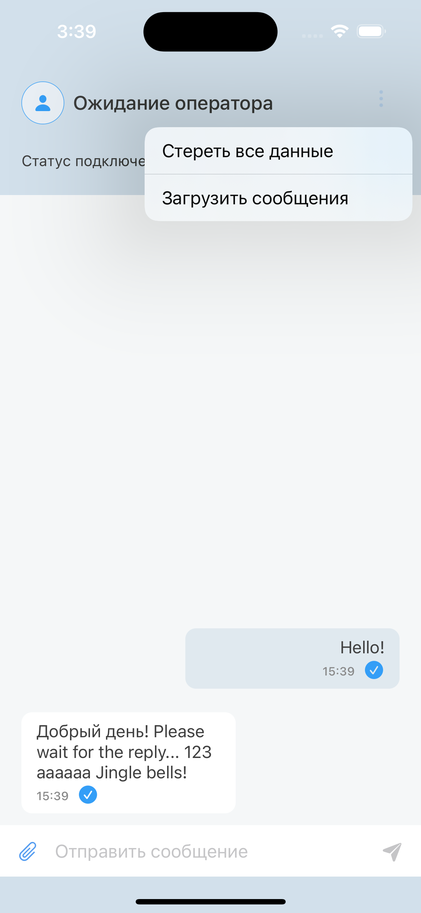

# Chat2Desk SDK Demo

This application demonstrates chat integration using Chat2Desk iOS SDK, allowing users to perform various chat operations with Chat2Desk service

## Features
The application supports the following features:
- Sending message
- Sending message with attachment
- Receiving incoming message
- Fetching message history from Chat2Desk
- Sending client data to the Chat2Desk
- Receiving operator info
- Saving message history and allowing users to add messages when there is no connection, followed by sending once a connection is re-established

## Getting started

You'll need a Chat2Desk  account on and a channel with Online Widget to get started.

1. Retrieve the parameters from the widget settings:
- widget token
- server URLs
2. Create `Config.xcconfig` file in the root folder with following content:
````
SIMPLE_SLASH = /
WIDGET_TOKEN = YOUR_WIDGET_TOKEN_HERE
BASE_HOST = YOUR_BASE_HOST_TOKEN_HERE
WS_HOST = YOUR_WS_HOST_TOKEN_HERE
STORAGE_HOST = YOUR_STORAGE_TOKEN_HERE
````
Note that you need to modify the URLs to escape //, as Xcode considers these characters to be the beginning of a comment. For example, use `https:$(SIMPLE_SLASH)/livechatv2-support.chat2desk.com`

3. Open `iOS SDK Demo.xcodeproj` in Xcode and wait for Swift Package Manager to resolve the SDK dependency.
   The project uses [chat2desk-sdk-spm](https://github.com/chat2desk/chat2desk-sdk-spm), pinned to version **1.5.14**.
   The `chat2desk_sdk` product is already linked to the application target.
4. Build and run the app.

## Usage

###  Message list
<table>
<tr>
<td>Main</td>
<td>Select Attachment</td>
<td>Dropdown menu</td>
</tr>
<tr>
<td></td>
<td></td>
<td></td>
</tr>
</table>

## Useful links
1. [Using Chat2Desk SDK](https://chat2desk.atlassian.net/wiki/external/453050405/NzFkMjYxOWI4OTdkNDg2MmIwMzA5NWYzYmViNDQ5YjU)
2. [SDK Reference](https://sdk.chat2desk.com)

## Still have questions?
- create an issue
